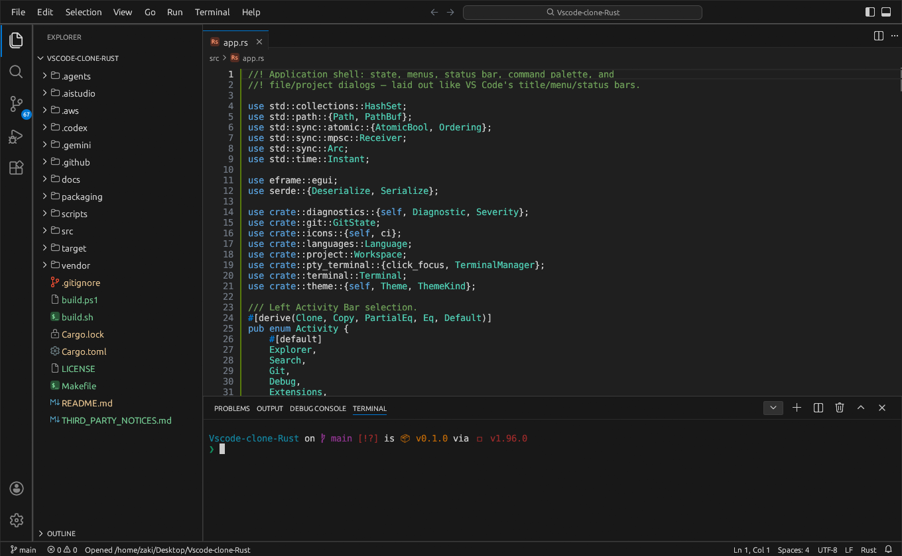
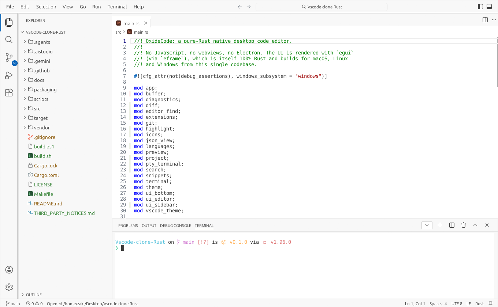
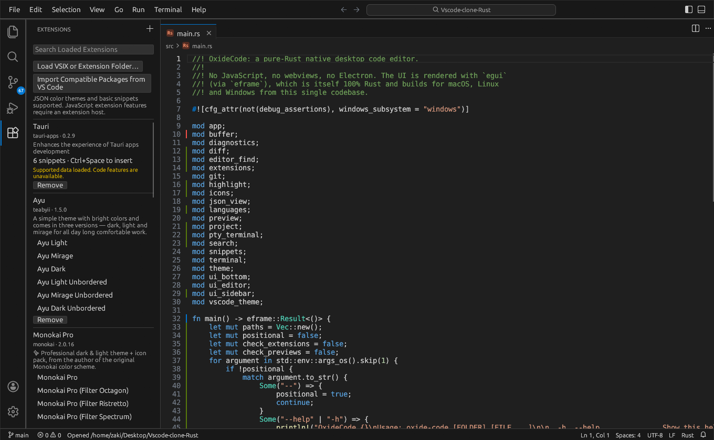
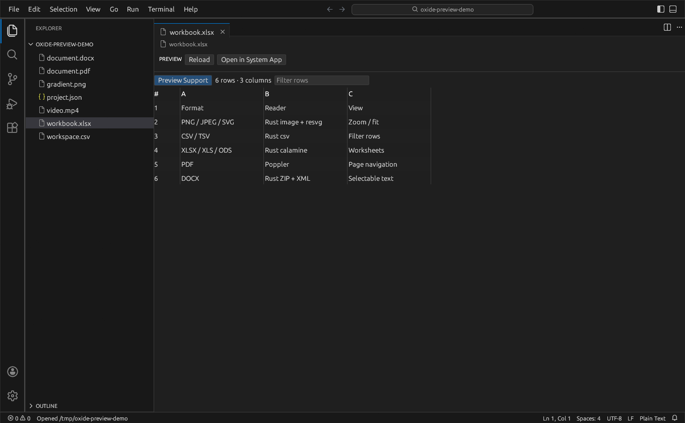
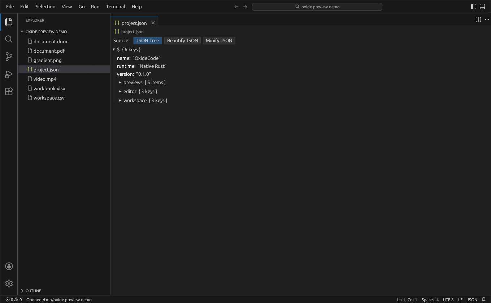
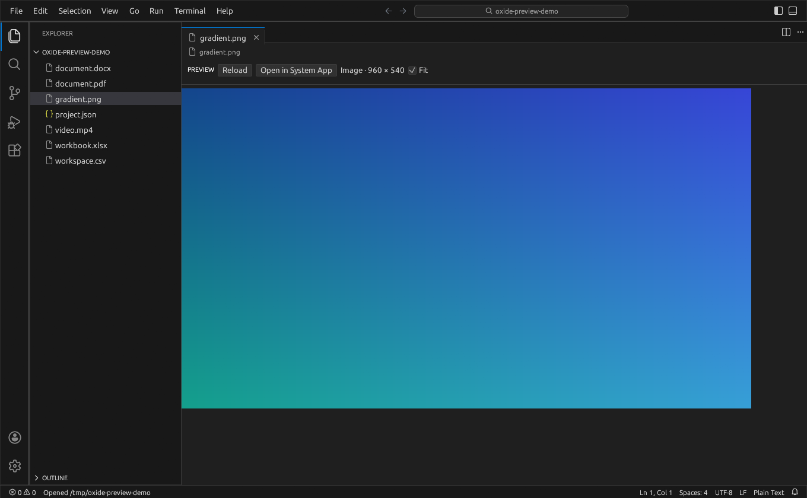
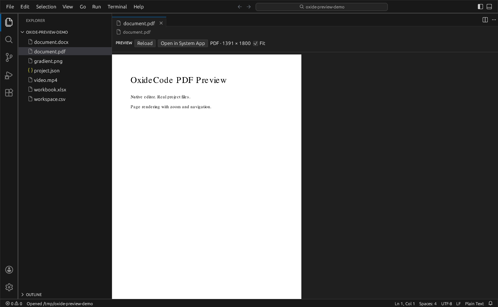
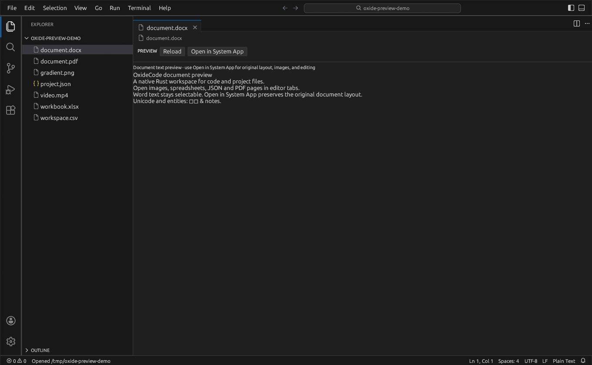
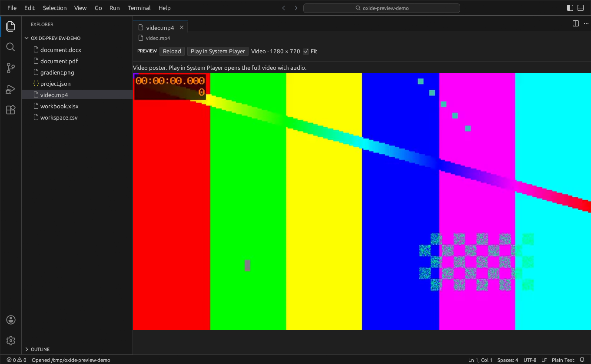

# Screenshots

Captured from the running native app using its own framebuffer. The preview
screens use generated fixture files, not mockups. The video screen is a poster;
full playback opens the system player. DOCX shows extracted body text.

## Editor

## Light Modern

## Imported extension contributions

## Excel worksheet

## JSON tree and formatting controls

## Image

## PDF

## Word document text

## Video poster and playback option

