# Sidebar redesign

The Search and Source Control mockups were generated with the built-in image
generation tool before application source was changed. The user selected their
balanced spacing. The exact design prompts are in [prompts.json](prompts.json).
Mockup text is illustrative; the implementation uses real workspace results and
Git state.

## Design references

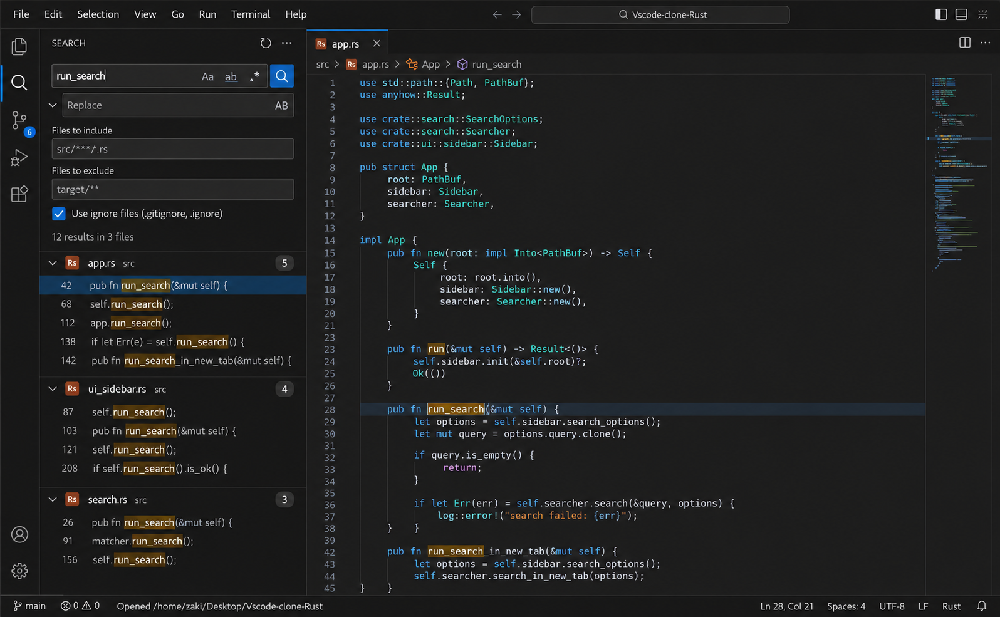

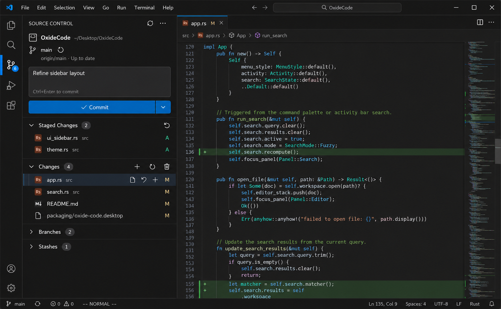

## Running application

These are native framebuffer captures from a temporary sample workspace. No user
Git repository or preferences are changed by the capture script.

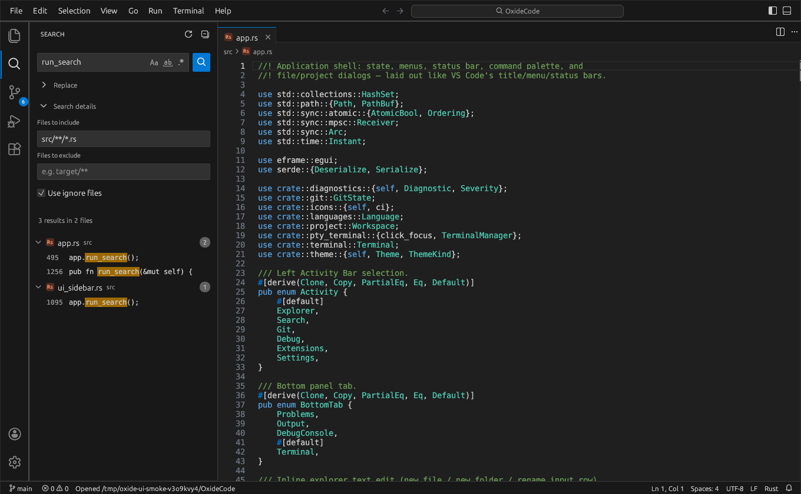

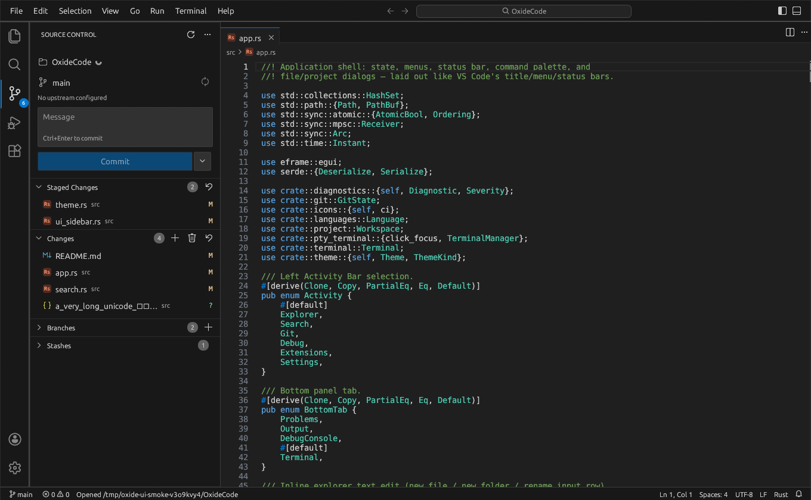

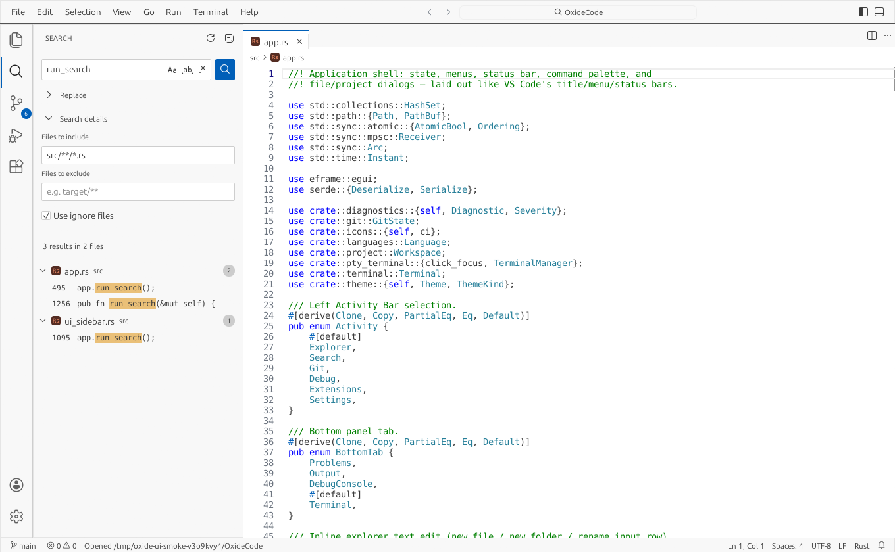

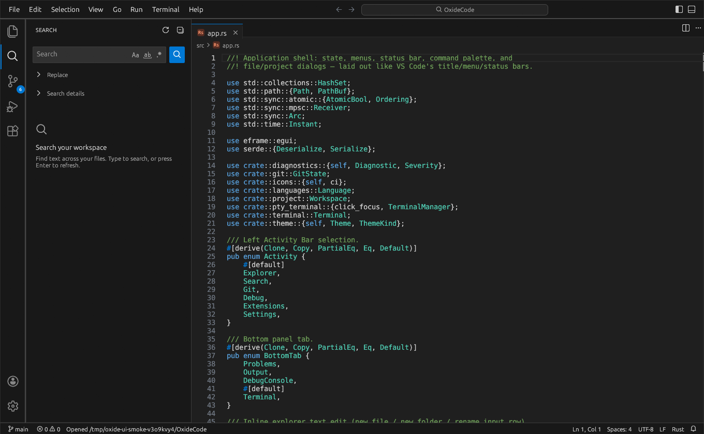

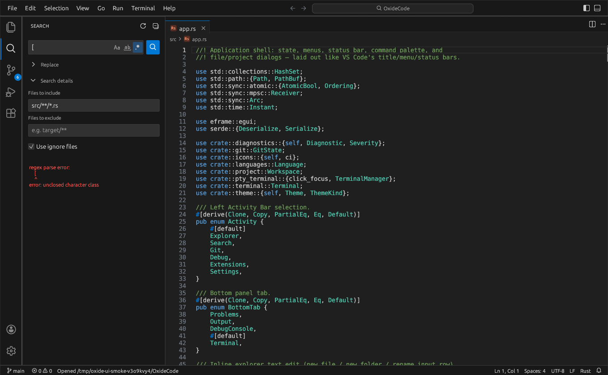

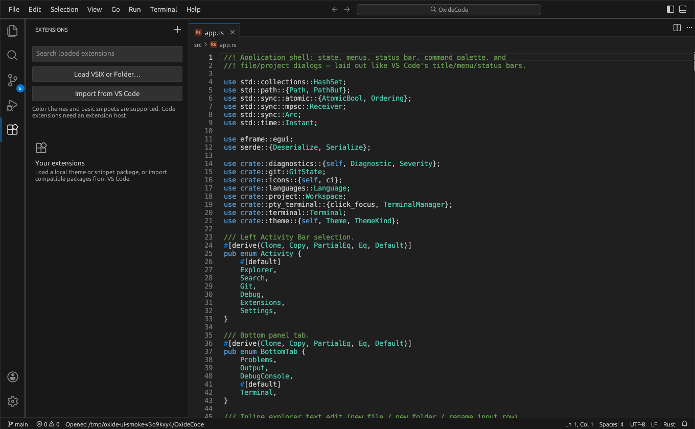

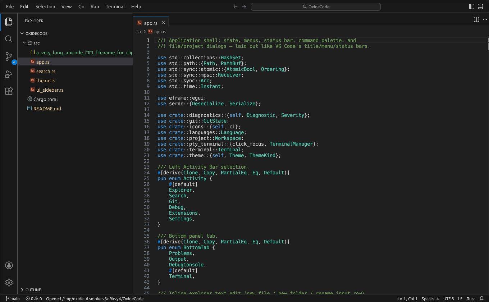

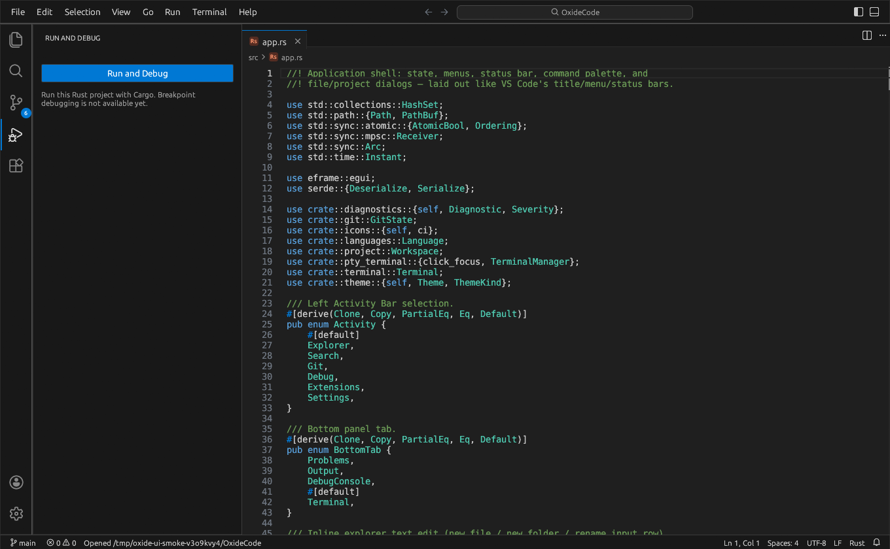

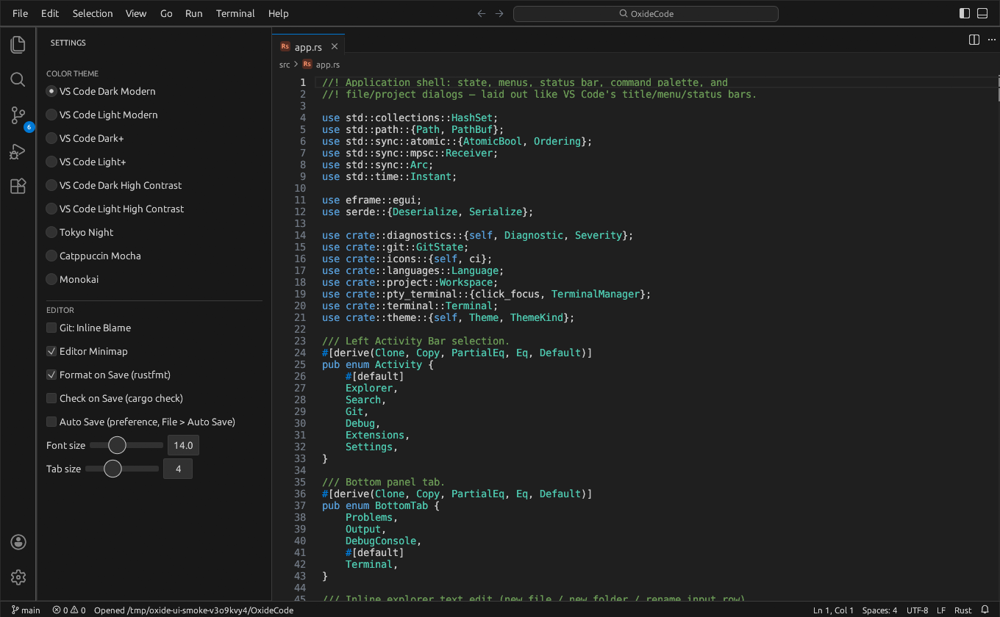

The sidebar starts at 320 points and can be resized from 260 to 420 points.
Search options sit inside the query field, while Replace and Search details
have separate disclosure controls. Typing starts a search after a 250 ms pause;
Enter and the search button refresh immediately. Results show line numbers,
match highlights, file counts, and full paths on hover. Replacement still uses
the existing confirmation and frozen-result validation. Search previews keep
bounded context around each match, including on very long minified lines;
tooltips are built only when shown, and result rendering borrows the frozen
files instead of cloning their contents every frame.

Source Control groups the repository, commit editor, staged changes, changes,
branches, and stashes. Fetch, pull, push, and other secondary actions are in the
ellipsis menu. File actions have reserved space so paths cannot overlap them.
Branches and stashes start collapsed. Existing destructive-action confirmations
remain in place. All colors come from the selected theme.

To recreate the captures with an active desktop session:

```sh
cargo build --release --locked
python3 scripts/ui_smoke.py
```

Use `--scenario search` to capture one panel, `--binary target/debug/oxide-code`
to inspect a development build, or `--output /tmp/oxide-ui-check` to keep
validation captures outside the documentation directory.

Layout tests cover long Unicode previews, highlight offsets, independent group
and toolbar click targets, and stable search widths across multiple frames at
260, 320, and 420 points.
